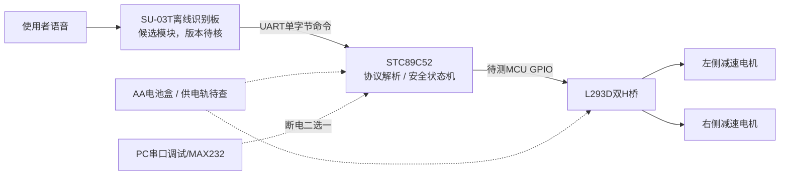
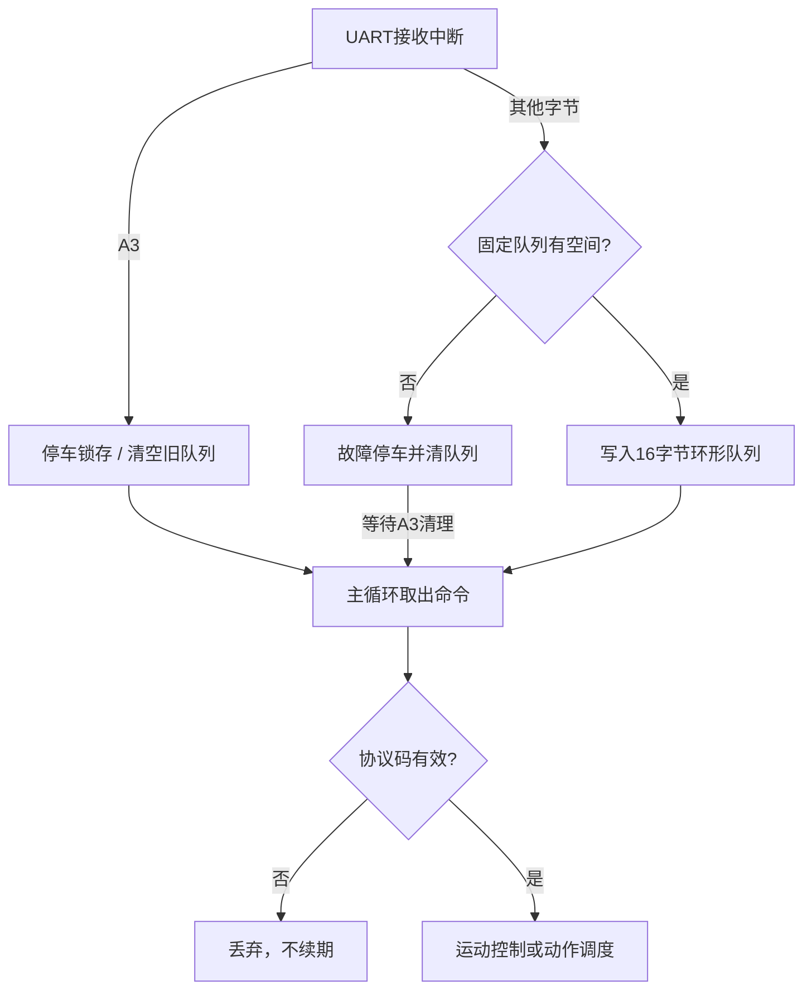
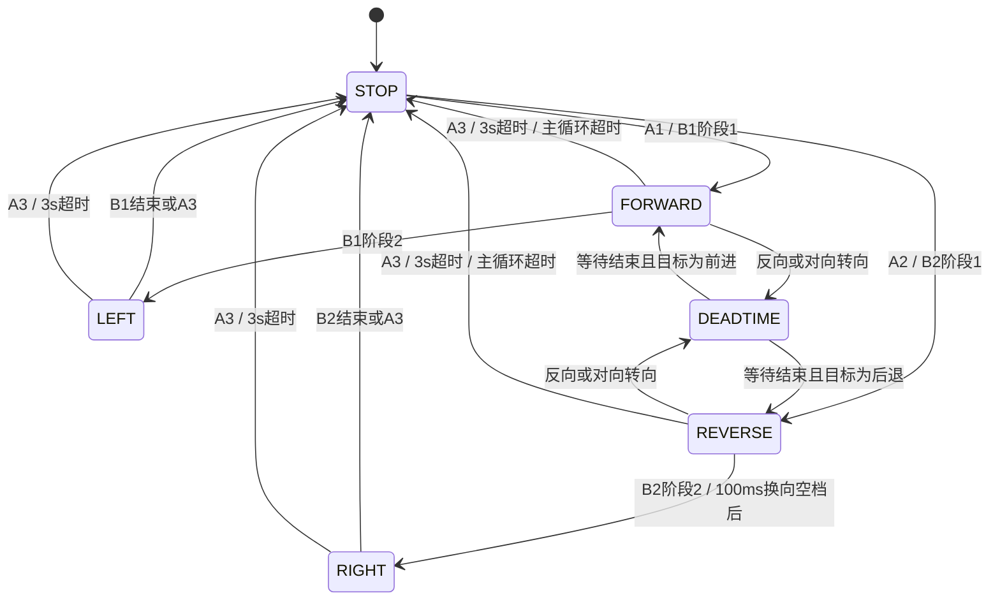

# 基于语音控制的智能小车设计说明书技术素材（第一阶段草稿）

> 本文是报告技术素材，不是实物验收结论。资料来源为用户提供的《语音小车.docx》、主板和传感器板照片、配套BOM及对应器件厂商资料。现有主板仍待焊接。除本文件所列的主机软件测试和Keil C51编译外，焊接、上电、烧录、语音识别、PWM波形及车轮动作均未完成，需在后续用实验记录替换计划性描述。

## 摘要

本设计面向桂林航天工业学院《微处理器与接口技术》课程设计第20题，目标是以已有51单片机教学车为基础，增加离线语音控制，实现前进、后退、加速、减速、停止，并完成至少两组连续动作。现有套件BOM列有STC89C52系列DIP40单片机、11.0592MHz晶振、L293D双H桥驱动、MAX232串口转换、两台直流减速电机、四节AA电池盒和LM393红外传感器板。语音开发板暂拟使用SU-03T离线语音板，须在购买后核对具体版本引脚、电源和运行UART。

第一阶段已建立Keil C51源代码工程、主机端共用固件逻辑测试、两种时钟模式构建脚本、硬件连接复核清单和可编辑KiCad审查页。PC测试覆盖单字节协议、运动状态、速度限制、超时停车、动作顺序、急停、缓存溢出和主循环停滞；Keil C51 9.59已完成12T及6T代码编译链接并导出HEX。工程内无已测得的主板电气网络，未映射的MCU端口保持未配置，硬件版构建因此受阻止。第一阶段的成果是可审查的软件框架与实物测量准备，不代表样车已经运动。

## 一、系统总体结构

系统分为语音输入、单片机控制、功率驱动、电机执行和电源五部分。使用者说出已配置的命令后，SU-03T离线语音板识别词条，并通过UART发送一字节命令码。STC89C52接收串口数据，解析命令并更新非阻塞运动状态机。Timer2以定时中断推进系统节拍和软件PWM，控制器按命令计算左右轮目标状态。L293D将逻辑控制转换成两路H桥输出，驱动左右减速电机。供电部分需要分别确认MCU与MAX232逻辑轨、L293D逻辑电源和电机电源；当前这些网络在原板上的实际走向尚未确认。

软件结构采用UART BSP、Timer BSP、语音协议、核心命令队列、运动控制器、动作序列、安全停车接口和硬件配置层。主机测试直接编译协议和状态机源码，通过虚拟时间推进检查行为，避免另写一套算法产生测试偏差。硬件相关文件通过 `board_config.h` 设置时钟、波特率和安全确认门槛。电机端口尚无映射，因此当前Hardware目标不能生成可直接驱动现有PCB的最终固件。

图中的虚线仅表示电源或调试候选关系，并非当前主板的已验证网络。原板连接必须通过断电测量确认。

## 二、51单片机最小系统

套件拟采用STC89C52系列DIP40单片机，配套11.0592MHz晶振。按8051标准引脚定义，DIP40第40脚为VCC、第20脚为GND，第18/19脚为XTAL2/XTAL1，第9脚为RST，第31脚为EA/VPP；串口接收和发送复用P3.0/RXD（第10脚）与P3.1/TXD（第11脚）。这些是芯片标准引脚功能，不能据此推断PCB其他器件或插座实际连接。晶振与C7/C8的连接、复位网络极性和EA拉高方式必须通过焊后或现板断电通断测量、放大照片及芯片数据手册核对。

STC89C52不同具体尾缀及其工作模式可能影响ROM容量、ISP设置和机器周期。工程按11.0592MHz分别编译12T和6T目标：9600bps、SMOD=0时Timer1模式2的重装值分别为FDh与FAh；Timer2节拍参数亦按时钟模式分别计算。软件编译目标并不改变MCU实际模式，烧录设置和波形还须实测一致。最小系统验收应先拔除电机与驱动芯片，验证供电电压、静态电流、复位释放、晶振起振和串口下载，然后才进入电机测试。

## 三、L293D电机驱动与方向控制

L293D是双H桥驱动器。标准DIP16脚位中1、9为两组使能，2、7、10、15为输入，3、6、11、14为对应输出，4、5、12、13为地，16脚为逻辑电源VCC1，8脚为电机电源VCC2。芯片数据手册规定了器件脚位和电压边界，但不能说明现有教学板怎样把MCU端口连到输入/使能，也不能确认电机端子与左右轮的对应。该部分仍需按 `PINOUT_TRACE.csv` 对照芯片缺口方向、断电测阻、记录电机插座和MCU焊盘的阻值。

软件运动接口按双轮差速方式抽象：前进为左右轮同向，后退为左右轮反向，左转暂按左轮停止、右轮前进，右转相反。最终左右轮极性和L293D输入对应必须在电气关系确认后校准。速度由32级软件PWM占空档表示，起始档16/32，限制8/32至28/32，每次加减4级；PWM频率设计约112.5Hz。这些都是程序初始值，而非电机实测值。L293D输出压降、堵转电流和热耗散会影响实际转速和温升，不能把数据手册绝对最大通道电流直接当成允许的长期负载。第一轮转测试要抬高驱动轮、限流供电并逐通道短时运行。

## 四、语音模块、UART与串口冲突

应用层拟定单字节命令码：A1前进、A2后退、A3停止、A4加速、A5减速、A6左转、A7右转、B1动作一、B2动作二。在线路上传输的字节为十六进制A1至A7、B1、B2，而不是ASCII字符“A1”。该映射属于应用协议，不是SU-03T默认出厂命令。模块购买后须在其工具中配置中文词条及对应UART输出字节，并在板上验证运行串口而非烧录串口。

串口默认设计为9600bps、8数据位、无校验、1停止位。接收中断读取单字节并写入固定长度环形队列，主循环按顺序解析。非法字节不触发运动；队列溢出或检测到的帧错误触发停车故障；A3停止命令设置最高优先级锁存，丢弃积压指令并取消动作。清理故障后才接受新运动指令。8N1单字节没有校验和，因此不能检测所有把噪声变成另一个有效码的情形；软件不能假称硬件具备不存在的接收溢出标志。

现有MAX232用于RS-232与MCU UART的电平转换；MAX232接收输出通常可能与MCU RXD相连，实际PCB路径需测量。若PC的发送源和语音板TX同时连到MCU RXD，会造成总线争用。建议使用断电切换模式：PC调试时使用MAX232并拔除语音TX；语音运行时隔离PC发送源及未选MAX232接收输出，只保留语音TX→MCU RXD。仅拔DB9线不必然保证MAX232输出已隔离。SU-03T具体开发板可能含稳压和串口电路，必须核对手册、PCB丝印、电压电平和供电能力；先采用单向发送，不连接MCU TX到语音板，除非模块文档明确要求。

## 五、电池和电源安全

BOM中四节AA电池盒及PCB/DC6V标记已确认存在，但电池化学体系未知。不同AA电池的开路电压、满电压和放电曲线不同，电池盒标称约6V不等于稳定5V逻辑供电。当前BOM没有明确列出独立稳压器；照片不能判断DC输入如何分配到IC1第40脚、MAX232第16脚和L293D第16/8脚。不能把未稳压6V直接接到MCU或MAX232。MAX232和具体STC器件的供电上限须按各自正式数据手册复核；L293D的逻辑轨与电机轨也要按负载和器件压降评估。

在确认电源网络之前，断开电池、电机、USB和语音板；测量电池输入、开关、C17及各IC供电脚的断电关系与电阻，确认方向并考虑电容充电路径。电阻读数不能只靠蜂鸣判断短路。确认无异常后，才用稳定、限流的5V逻辑电源验证最小系统，并记录空板、插入MCU后的电流和压降。电机供电需结合电机额定电压、堵转电流、L293D压降和电池能力另行决定；启动造成的供电跌落可能引发单片机复位，须在架空轮子测试中测量。

## 六、PWM运动及连续动作状态机

Timer2以约3600Hz中断作为32级软件PWM时基，每36次中断生成10ms系统节拍，初步PWM频率约112.5Hz。定时器中断只执行短时计数与安全状态更新；UART接收不被动作延时阻塞。基础运动命令设置3秒运动超时；运动阶段若主循环100ms没有服务定时心跳，则安全接口撤销输出并锁定停车。方向转换在目标方向相反时先停止100ms，再进入新运动，减少直接反转造成的电流冲击。上述时间均为软件设计值，需在实物上检查实际响应、机械惯性和电机特性。

B1动作表为前进1000ms、左转500ms、停止；B2为后退700ms、右转500ms、停止。动作调度以10ms时基推进，不使用长时间delay。阶段时间从状态机进入阶段起计算；换向死区额外计入。任意时刻到达A3都立即撤销输出、取消组合动作并清除旧队列。动作结束强制停车。方向命令中断并接管当前序列，B1/B2可启动或替换序列，加减速在运动过程中调整占空档。

PWM占空比以32级表示，定时中断频率设计为3600Hz，则一组32级PWM约为112.5Hz。占空档16/32约为50%；软件控制量不直接等同电机端有效电压，因为L293D存在压降，电机负载、减速箱和供电下垂都会改变转速。

## 七、软件和测试方法

固件采用Keil C51兼容的传统C语言、静态队列和固定大小变量。主机端测试使用MSVC编译相同的协议、运动和动作源码，以确定性方式推进10ms虚拟节拍。当前测试覆盖九种合法码、ASCII误输入与非法字节、前后左右运动、加减速边界、停车不自启、换向空档、两组连续动作、中途停止、动作替换、3秒超时、时钟回绕、串口故障、队列满时停止优先级以及主循环停滞。主机测试通过只证明共享C逻辑在测试模型下符合断言，并不证明中断时序、GPIO电平或实体车性能。

Keil C51 9.59已经对DryRun_12T和DryRun_6T分别编译、链接并输出HEX；链接报告显示代码1896字节、静态data 82字节、xdata 0字节。链接器提示17个未调用函数警告，主要为未在嵌入式入口中调用的查询或测试接口。尚未以STC芯片烧录或在硬件上执行HEX。实际运行栈使用量、目标芯片尾缀ROM和外部程序烧录设置仍待确认。

## 八、实验记录与问题分析

正式报告应增加测量日期、仪表型号、被测点、芯片丝印、电池类型、稳压来源、逻辑轨和电机轨电压、电机启动/空载电流、L293D温度、串口波形、PWM波形和动作结果。每次语音实验需要分别统计识别成功与运动执行，不要只凭主观印象填写识别率。尚未取得的数值以空栏记录，不能编造数据。

| 项目 | 实验步骤 | 应保存证据 | 当前结论 |
|---|---|---|---|
| H01 电源网络 | 拔除电池和模块，测输入至IC电源脚 | 阻值、开关状态、照片 | NOT TESTED |
| H02 最小系统 | 限流逻辑供电，不接电机 | VCC、电流、复位与晶振波形 | NOT TESTED |
| H03 下载串口 | 确认适配线、电平和TX/RX | COM信息、ISP截图、回显 | NOT TESTED |
| M01 电机 | 架空轮子逐路短时运行 | 电机方向、电流、温升 | NOT TESTED |
| M02 PWM | 示波器测使能/输入及占空变化 | 频率、占空、测点 | NOT TESTED |
| V01 语音 | 配置命令后逐条重复识别 | 词条、模块输出码、执行结果 | NOT TESTED |
| A01 连贯动作 | 分别触发B1/B2并发出急停 | 时间戳、视频、动作阶段 | NOT TESTED |

目前确认的主要风险是原板供电拓扑和端口映射不明、MAX232可能与语音UART共用RXD、电池输入未必是稳压逻辑轨、以及电机启动压降可能复位单片机。处理方式是先断电测量并记录，再基于真实网络确定隔离、稳压及驱动方案。KiCad审查页采用文字标明标准引脚和待测事项，当前没有画出PCB实际电气网络；PDF导出、空网表解析和零违规ERC仅说明文件可读，不是板卡验收。

## 九、开发日志与完成边界

2026年10月14日建立工程骨架、需求追踪矩阵、硬件测量表、C51共享状态逻辑、主机测试、12T/6T构建入口、KiCad可编辑审查页和报告素材；修正了主机与C51整型宽度差异，并通过C51编译链接。待办为焊接后测量、电源安全验证、引脚配置、STC-ISP烧录、架空电机试转、SU-03T采购与配置、动作校准、实物记录补充和最终说明书整理。交付成果仅覆盖第一阶段软件和技术资料准备，不宣称实体样车、语音识别或课程验收已经完成。
